# COMP 3613 Assignment 2: Testing the Internship Platform

**Name:** Kriston Latoo

## Project Description

InternMatch is a departmental internship platform. Companies post internship positions, students browse open positions and apply, and an administrator manually matches students to positions. The application is built with FastAPI and SQLModel, with a server-rendered web UI and a JSON REST API that share the same service layer.

Three main workflows:

1. **Post Internship Position (Company):** a company enters a title, description and number of slots. The position goes live for students immediately.
2. **Apply for Internship (Student):** a student browses open positions and applies once per position with an optional cover note. The application starts as `Submitted`.
3. **Match Applications (Admin):** the admin reviews applications per position and assigns a student. The application becomes `Matched` and the position loses one available slot.

Business rules:

- A student can apply to a position only once.
- A student can be matched to only one position.
- A position with no available slots is hidden from students and cannot receive more matches.
- Only companies post positions, only students apply, and only the admin matches.

## Use Case Diagram

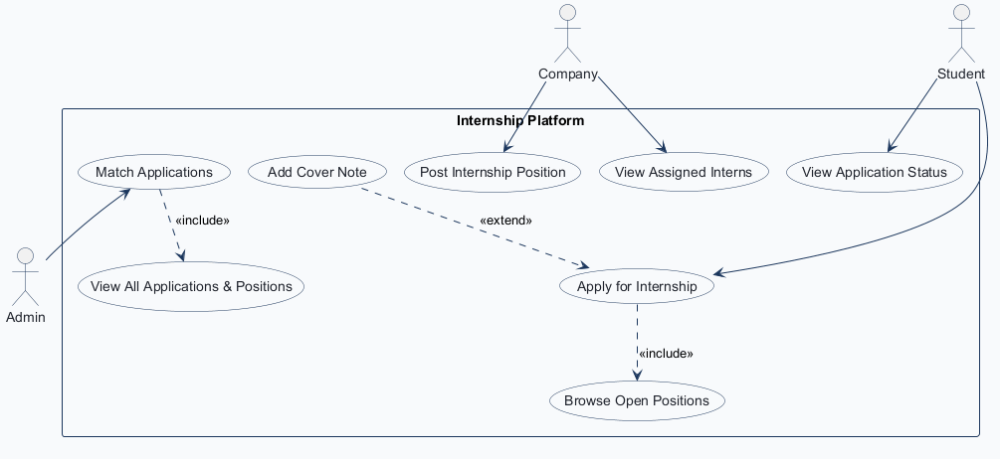

## Entity Relationship Diagram

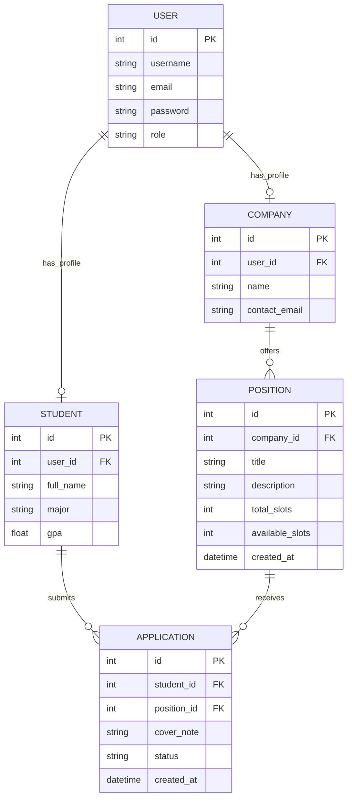

## Application Wireframes

### W1: Post Internship Position (Company)

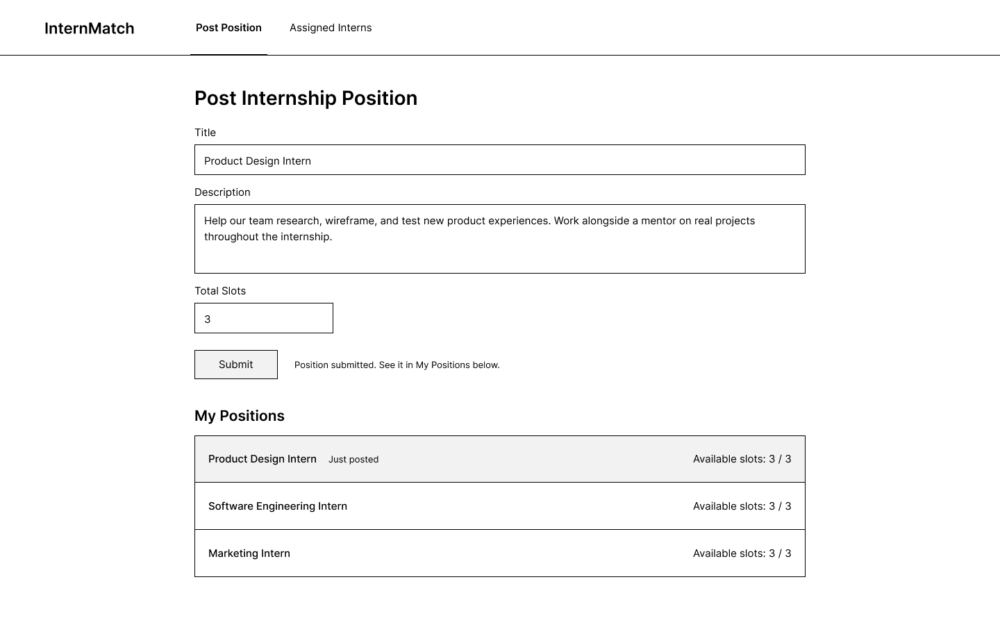

### W2: Browse Open Positions and Apply (Student)

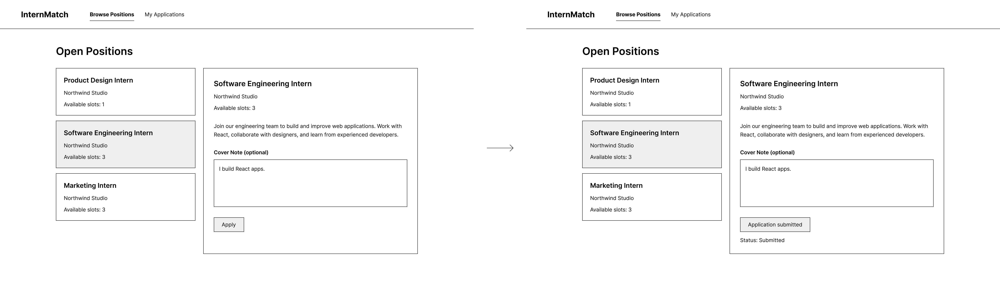

### W3: My Applications (Student)

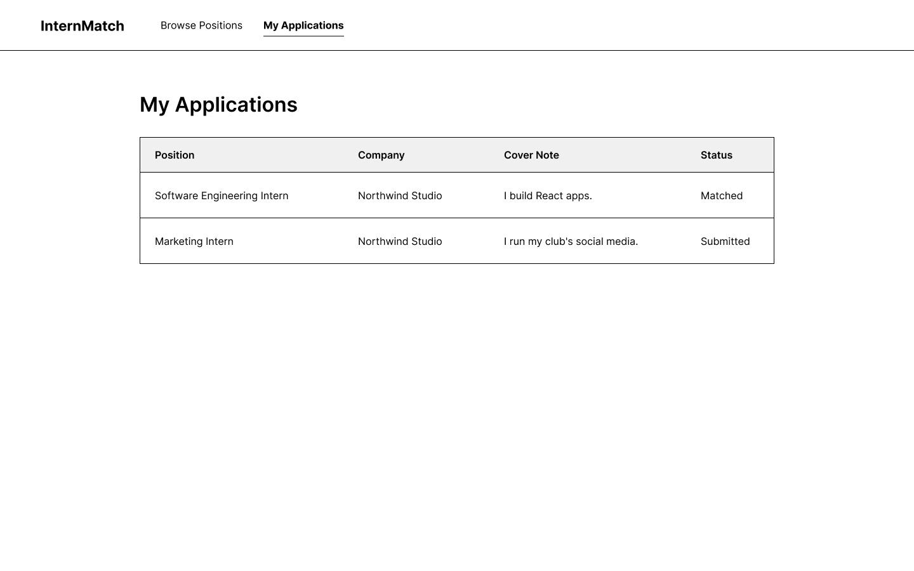

### W4: Matching Workspace (Admin)

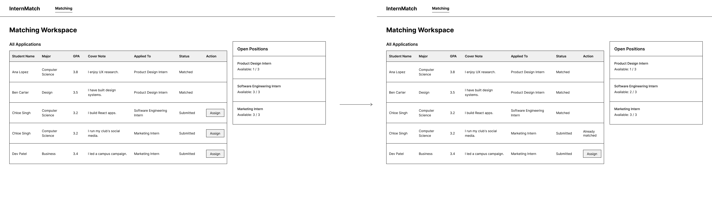

### W5: Assigned Interns (Company)

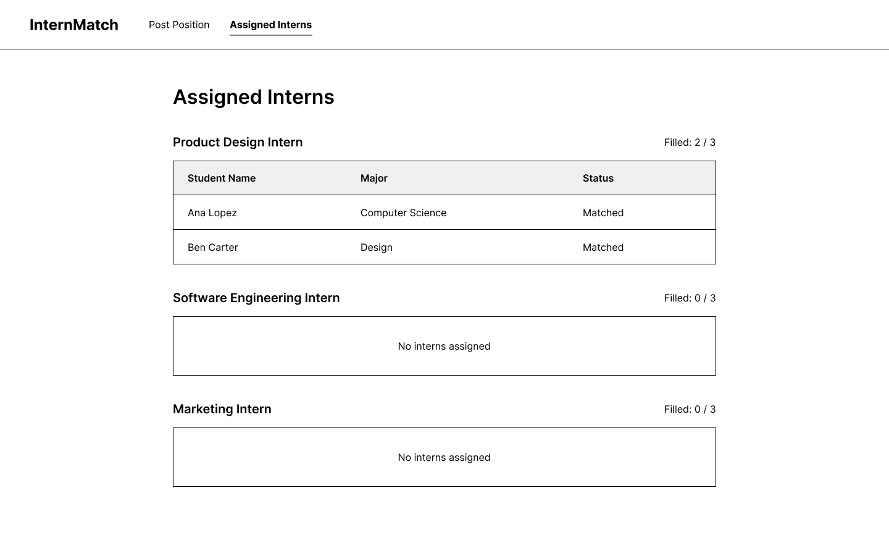

---

# Testing

## User Acceptance Test Plan

User acceptance test steps are made with reference to the wireframes (W1 to W5).

**Pre-conditions:** what state the app should already be in, and which type of user the tester should be logged in as.
**Test Steps:** exactly what actions the user should perform on the UI.
**Test Criteria:** what the user should see if they successfully complete the steps, and how they can verify on the UI that the operation was successful.

Before testing, reset and seed the database with `python manage.py init`, then start the app with `python manage.py run` and open http://localhost:5000.

| Role | Username | Password |
|---|---|---|
| Admin | admin | adminpass |
| Company | northwind | companypass |
| Student | student1 | studentpass |

<table class="uat">
<tr><th rowspan="2">Test Case</th><th rowspan="2">Pre-conditions</th><th rowspan="2">Test Steps</th><th rowspan="2">Test Criteria</th><th colspan="2">Success (indicate with a ✓)</th></tr>
<tr><th>Pass</th><th>Fail</th></tr>
<tr><td>1.1 Test Login</td><td>None</td><td>☐ Open http://localhost:5000 and click <b>Sign in</b> ☐ Fill out the form with a valid username and password (admin / adminpass, northwind / companypass or student1 / studentpass) ☐ Press the <b>Sign in</b> button</td><td>☐ An Admin is directed to the <b>Matching Workspace</b> page ☐ A Company is directed to the <b>Post Position</b> page ☐ A Student is directed to the <b>Browse Positions</b> page ☐ <b>Logout</b> is shown at the top right of the navbar</td><td class="pf"></td><td class="pf"></td></tr>
<tr><td>1.2 Test Invalid Login</td><td>None</td><td>☐ On the sign-in page enter username <b>admin</b> and a wrong password ☐ Press the <b>Sign in</b> button</td><td>☐ User remains on the sign-in page ☐ User is alerted "Incorrect username or password"</td><td class="pf"></td><td class="pf"></td></tr>
<tr><td>1.3 Test Post Position</td><td>☐ Must be logged in as a Company</td><td>☐ On the <b>Post Position</b> page (wireframe W1) fill out the form: Title "UAT Test Intern", a short description, Total Slots 2 ☐ Press the <b>Submit</b> button</td><td>☐ The new position appears at the top of <b>My Positions</b> ☐ The position is marked "Just posted" ☐ The position shows Available slots 2 / 2</td><td class="pf"></td><td class="pf"></td></tr>
<tr><td>1.4 Test Post Position with Blank Title</td><td>☐ Must be logged in as a Company</td><td>☐ On the <b>Post Position</b> page (W1) leave Title empty and fill in a description ☐ Press the <b>Submit</b> button</td><td>☐ The form is not submitted ☐ The Title field shows "Please fill out this field." ☐ No new position appears in <b>My Positions</b></td><td class="pf"></td><td class="pf"></td></tr>
<tr><td>1.5 Test Browse Positions</td><td>☐ Must be logged in as a Student ☐ Position from 1.3 exists</td><td>☐ On the <b>Browse Positions</b> page (W2) scroll through the list of positions ☐ Click on "UAT Test Intern"</td><td>☐ The new position is listed without any admin approval ☐ The details panel shows the company, description and "Available" status</td><td class="pf"></td><td class="pf"></td></tr>
<tr><td>1.6 Test Apply for Internship</td><td>☐ Must be logged in as a Student ☐ The position is open and the student has not applied to it</td><td>☐ On <b>Browse Positions</b> (W2) select "UAT Test Intern" ☐ Type a cover note ☐ Press the <b>Apply</b> button ☐ Select "Marketing Intern", type a cover note and press <b>Apply</b> (needed for 1.11)</td><td>☐ User is alerted "Application submitted successfully." ☐ The details panel shows "Application submitted" and status Submitted ☐ Both applications are submitted</td><td class="pf"></td><td class="pf"></td></tr>
<tr><td>1.7 Test Duplicate Application</td><td>☐ Must be logged in as a Student ☐ Student has already applied to "UAT Test Intern"</td><td>☐ On <b>Browse Positions</b> (W2) select "UAT Test Intern" again</td><td>☐ The <b>Apply</b> button and Cover Note box are no longer shown ☐ The position shows status Submitted, so it cannot be applied to twice</td><td class="pf"></td><td class="pf"></td></tr>
<tr><td>1.8 Test View My Applications</td><td>☐ Must be logged in as a Student ☐ Student has submitted at least one application</td><td>☐ Click on <b>My Applications</b> in the navbar (W3)</td><td>☐ "UAT Test Intern" is listed ☐ The row shows company Northwind Studio, the cover note and status Submitted</td><td class="pf"></td><td class="pf"></td></tr>
<tr><td>1.9 Test View Applicants</td><td>☐ Must be logged in as an Admin ☐ student1 has applied to "UAT Test Intern"</td><td>☐ On the <b>Matching Workspace</b> page (W4) click "UAT Test Intern" under Open Positions</td><td>☐ Student One's application is shown with major, GPA and cover note ☐ Remaining slots shows 2 / 2 ☐ An <b>Assign student</b> button is shown</td><td class="pf"></td><td class="pf"></td></tr>
<tr><td>1.10 Test Match Application</td><td>☐ Must be logged in as an Admin ☐ Student One's application to "UAT Test Intern" is pending</td><td>☐ On <b>Matching Workspace</b> (W4) select "UAT Test Intern" ☐ Press <b>Assign student</b> on Student One's application</td><td>☐ User is alerted "Application matched successfully." ☐ The application status changes to Matched ☐ Remaining slots changes to 1 / 2</td><td class="pf"></td><td class="pf"></td></tr>
<tr><td>1.11 Test Already Matched Student</td><td>☐ Must be logged in as an Admin ☐ Student One was matched in 1.10 ☐ Student One applied to "Marketing Intern" in 1.6 ☐ Seeded applicants Mia Ross, Noah Chen and Sophia Nguyen have also applied to "Marketing Intern"</td><td>☐ On <b>Matching Workspace</b> (W4) click "Marketing Intern" under Open Positions</td><td>☐ Student One's application shows "Already matched" ☐ Its button is disabled and cannot be pressed ☐ Other applicants still show <b>Assign student</b></td><td class="pf"></td><td class="pf"></td></tr>
<tr><td>1.12 Test Matched Status for Student</td><td>☐ Must be logged in as a Student ☐ Student's application was matched in 1.10</td><td>☐ Click on <b>My Applications</b> in the navbar (W3)</td><td>☐ "UAT Test Intern" shows status Matched ☐ The student's other application still shows Submitted</td><td class="pf"></td><td class="pf"></td></tr>
<tr><td>1.13 Test View Assigned Interns</td><td>☐ Must be logged in as a Company ☐ A student has been matched to one of its positions</td><td>☐ Click on <b>Assigned Interns</b> in the navbar (W5)</td><td>☐ Student One is listed under "UAT Test Intern" ☐ The position shows 1 / 2 filled ☐ Positions with no matches show "No interns assigned."</td><td class="pf"></td><td class="pf"></td></tr>
<tr><td>1.14 Test Role Access Restriction</td><td>☐ Must be logged in as a Student</td><td>☐ Enter http://localhost:5000/admin in the address bar ☐ Enter http://localhost:5000/company in the address bar</td><td>☐ The admin page does not open; a 401 Unauthorized page is shown ☐ The company page does not open; "Company access required" is shown</td><td class="pf"></td><td class="pf"></td></tr>
</table>

## Unit Test Plan

Each module is tested on its own. Service tests replace every repository with a mock (`unittest.mock`), so only the business rules are tested. Repository tests run against a new in-memory SQLite database for each test.

**test_security.py**

| Unit Test | Input | Expected Output |
|---|---|---|
| test_encrypt_password_does_not_store_plain_text() | "secret" | hash != "secret" and "secret" not in hash |
| test_encrypt_password_salts_each_hash() | "secret" hashed twice | the two hashes are different |
| test_verify_password_accepts_correct_password() | "secret", hash of "secret" | verify_password(...) == True |
| test_verify_password_rejects_wrong_password() | "wrong", hash of "secret" | verify_password(...) == False |
| test_access_token_contains_subject_role_and_expiry() | {"sub": "5", "role": "student"} | decoded token sub == "5", role == "student", has exp |
| test_expired_access_token_is_rejected() | {"sub": "5"}, expires 1 second ago | decoding raises ExpiredSignatureError |
| test_cookie_is_http_only() | None | access_token_cookie_kwargs()["httponly"] == True |

**test_auth_service.py (user repository mocked)**

| Unit Test | Input | Expected Output |
|---|---|---|
| test_authenticate_returns_token_for_valid_credentials() | "alice", "pass123" | token returned; decoded sub == "1", role == "student" |
| test_authenticate_returns_none_for_wrong_password() | "alice", "wrong" | None |
| test_authenticate_returns_none_for_unknown_user() | "nobody", "pass123" | None |
| test_authenticate_resolves_login_alias() | "company1", "companypass" | token returned for the northwind account |
| test_register_user_hashes_password_and_sets_role() | "carol", "carol@example.com", "pass123", role "company" | user.role == "company", user.password != "pass123" |

**test_internship_service.py (all repositories mocked)**

| Unit Test | Input | Expected Output |
|---|---|---|
| test_create_position_saves_trimmed_values() | "  Data Intern  ", "  Analyse data ", 2 | position saved with "Data Intern", "Analyse data", 2 |
| test_create_position_rejects_blank_fields() | ("", "Desc"), ("   ", "Desc"), ("Title", ""), ("Title", "   ") | InvalidInputError raised; nothing saved |
| test_create_position_creates_company_profile_when_missing() | company user with no profile, "Title", "Desc", 1 | company profile created, then position saved |
| test_submit_application_creates_application() | student user, position 10, "Hire me" | application created for student 4, position 10 |
| test_submit_application_rejects_non_student() | company user, position 10 | PermissionDeniedError |
| test_submit_application_rejects_missing_position() | student user, position 99 (does not exist) | NotFoundError |
| test_submit_application_rejects_full_position() | position with available_slots = 0 | ConflictError "no longer open" |
| test_submit_application_rejects_duplicate() | student already applied to position 10 | ConflictError "already applied" |
| test_submit_application_rejects_already_matched_student() | student already matched elsewhere | ConflictError "already matched"; nothing saved |
| test_match_application_matches() | admin user, application 1 | application 1 matched |
| test_match_application_requires_admin() | company user, application 1 | PermissionDeniedError; nothing changed |
| test_match_application_rejects_unknown_application() | admin user, application 999 | NotFoundError |
| test_match_application_rejects_already_matched_application() | application with status "Matched" | ConflictError |
| test_match_application_rejects_student_matched_elsewhere() | student already matched to another position | ConflictError "already matched" |
| test_match_application_rejects_full_position() | position with available_slots = 0 | ConflictError "no remaining slots" |
| test_ensure_role_profile_creates_student_profile() | new student user "dan" | student profile "Dan", "Undecided", 0.0 |
| test_ensure_role_profile_creates_company_profile() | new company user "globex" | company profile "Globex", "globex@example.com" |
| test_service_errors_are_value_errors_for_html_views() | service error classes | every error class is a ValueError |

**test_repositories.py (fresh in-memory database per test)**

| Unit Test | Input | Expected Output |
|---|---|---|
| test_user_repository_create_and_lookup() | "dan", "dan@example.com" | user found by username and by id |
| test_user_repository_rejects_duplicate_username() | "dan" created twice | IntegrityError |
| test_user_repository_unknown_username_returns_none() | "ghost" | None |
| test_company_ensure_for_user_is_idempotent() | same company user twice | same company id returned both times |
| test_student_ensure_for_user_keeps_existing_profile() | existing "Erin Lee", called with "Other Name" | full_name stays "Erin Lee" |
| test_position_create_sets_available_slots_to_total() | "QA Intern", "Testing", 3 | total_slots == 3, available_slots == 3, created_at set |
| test_position_create_rejects_blank_title() | "  ", "Testing", 1 | ValueError |
| test_position_list_open_hides_full_positions() | positions with 1 slot and 0 slots | only the open position returned |
| test_position_list_by_company_only_returns_own() | positions for Acme and Globex | only "Acme Intern" returned for Acme |
| test_application_create_defaults_to_submitted() | cover note "  Hello  " | status == "Submitted", cover_note == "Hello" |
| test_application_create_rejects_duplicate() | same student and position twice | ValueError "already applied" |
| test_application_match_sets_status_and_reduces_slots() | application to a position with 2 slots | status == "Matched", available_slots == 1 |
| test_student_has_matched_application() | student before and after a match | False, then True |

## Integration Testing Plan

Integration tests send real HTTP requests through the app with FastAPI's `TestClient`, so routes, authorization, services, repositories and the database are tested together. Each test starts from a new in-memory database with one admin, one company with two positions, and two students.

**test_api_auth.py**

| Test | Dependencies | Description |
|---|---|---|
| test_login_returns_bearer_token_and_role() | POST /api/auth/login authenticate_user() | Ensures valid credentials return a bearer token and the user's role |
| test_login_with_wrong_password_returns_401() | POST /api/auth/login authenticate_user() | Ensures a wrong password returns 401 "Incorrect username or password" |
| test_login_with_missing_fields_returns_422() | POST /api/auth/login | Ensures a login body without a password is rejected with 422 |
| test_me_returns_logged_in_user() | POST /api/auth/login GET /api/auth/me get_current_user() | Ensures the logged-in user's details are returned without the password |
| test_web_login_cookie_also_authenticates_api() | POST /login GET /api/auth/me | Ensures the cookie from the web login form is accepted by the API |
| test_register_creates_student_with_profile() | POST /api/auth/register register_user() ensure_role_profile() | Ensures a new student account and profile are created and can log in |
| test_register_duplicate_username_returns_409() | POST /api/auth/register get_by_username() | Ensures an existing username cannot be registered again |
| test_register_cannot_create_admin() | POST /api/auth/register | Ensures the register endpoint cannot create an admin account (422) |
| test_protected_endpoint_without_token_returns_json_401() | GET /api/positions get_current_user() | Ensures a request with no token gets a JSON 401 |
| test_invalid_token_returns_401() | GET /api/positions get_current_user() | Ensures an invalid token is rejected with 401 |
| test_users_list_is_admin_only() | GET /api/users require_roles() get_all_users() | Verifies a student gets 403 and the admin gets all users without passwords |

**test_api_positions.py**

| Test | Dependencies | Description |
|---|---|---|
| test_company_can_post_position_and_it_is_live_immediately() | POST /api/positions create_position() GET /api/positions list_open_positions() | Ensures a company can post a position (201) and students see it straight away |
| test_student_cannot_post_position() | POST /api/positions require_roles() | Ensures a student cannot post a position (403) |
| test_admin_cannot_post_position() | POST /api/positions require_roles() | Ensures the admin cannot post a position (403) |
| test_post_position_rejects_invalid_body() | POST /api/positions | Ensures an empty title, 0 slots or a missing title are rejected with 422 |
| test_post_position_rejects_whitespace_title() | POST /api/positions create_position() | Ensures a title of only spaces is rejected with 400 and a message |
| test_get_single_position() | GET /api/positions/{id} PositionRepository.get_by_id() | Ensures the requested position is returned |
| test_get_unknown_position_returns_404() | GET /api/positions/{id} | Ensures an unknown position id returns 404 |
| test_company_positions_lists_only_own_positions() | GET /api/company/positions list_company_positions() | Ensures a company only sees its own positions |
| test_company_positions_is_company_only() | GET /api/company/positions require_roles() | Ensures a student cannot view a company's positions (403) |

**test_api_applications.py**

| Test | Dependencies | Description |
|---|---|---|
| test_student_can_apply_and_status_is_submitted() | POST /api/positions/{id}/applications submit_application() list_student_applications() | Ensures an application is created as Submitted and appears in My Applications |
| test_cover_note_is_optional() | POST /api/positions/{id}/applications submit_application() | Ensures a student can apply without a cover note |
| test_student_cannot_apply_twice_to_same_position() | submit_application() get_by_student_and_position() | Ensures a second application to the same position returns 409 |
| test_apply_to_unknown_position_returns_404() | submit_application() PositionRepository.get_by_id() | Ensures applying to an unknown position returns 404 |
| test_company_cannot_apply() | POST /api/positions/{id}/applications require_roles() | Ensures a company cannot apply (403) |
| test_students_only_see_their_own_applications() | list_student_applications() | Ensures one student cannot see another student's applications |
| test_admin_lists_all_applications() | GET /api/applications admin_dashboard() | Verifies the admin sees every student's applications |
| test_admin_can_filter_applications_by_position() | GET /api/applications?position_id= admin_dashboard() | Verifies the admin can list applicants for one position |
| test_non_admin_cannot_list_or_match_applications() | GET /api/applications PATCH /api/applications/{id} require_roles() | Ensures students and companies cannot list or match applications (403) |
| test_admin_match_sets_status_and_reduces_slots() | PATCH /api/applications/{id} match_application() ApplicationRepository.match() | Ensures matching sets status Matched, removes one slot and the student sees it |
| test_matched_intern_appears_for_company() | match_application() list_company_positions() | Ensures the matched student appears in the company's assigned interns |
| test_match_unknown_application_returns_404() | match_application() ApplicationRepository.get_by_id() | Ensures matching an unknown application returns 404 |
| test_match_with_invalid_status_returns_422() | PATCH /api/applications/{id} | Ensures a status other than Matched is rejected with 422 |
| test_student_cannot_be_matched_twice() | match_application() student_has_matched_application() | Ensures a student already matched cannot be matched again (409) |
| test_matched_student_cannot_apply_again() | submit_application() student_has_matched_application() | Ensures a matched student cannot apply to other positions (409) |
| test_full_position_is_hidden_and_cannot_be_matched_again() | match_application() list_open_positions() | Ensures a full position is hidden from students and cannot be matched again |

**test_web_workflows.py**

| Test | Dependencies | Description |
|---|---|---|
| test_login_redirects_each_role_to_its_dashboard() | POST /login authenticate_user() | Ensures admin, company and student are sent to their own dashboards |
| test_wrong_password_redirects_back_to_login() | POST /login authenticate_user() | Ensures a wrong password returns the user to the sign-in page |
| test_dashboards_block_other_roles() | POST /login GET /company | Ensures a student cannot open the company dashboard (403) |
| test_full_internship_flow_through_web_pages() | POST /company/positions POST /student/positions/{id}/apply POST /admin/applications/{id}/match GET /company?tab=interns | Ensures post, apply and match work end to end through the web forms |

**test_company_dashboard_view.py**

| Test | Dependencies | Description |
|---|---|---|
| test_company_assigned_interns_tab_renders_empty_state_for_its_own_positions() | company_home_view() list_company_positions() | Ensures the Assigned Interns tab shows only the company's own interns |
| test_new_student_profile_defaults_to_undecided_major_and_zero_gpa() | ensure_role_profile() StudentRepository.ensure_for_user() | Ensures a new student profile defaults to major Undecided and GPA 0.0 |
| test_seed_catalog_uses_clean_internship_dataset() | app.seed_data | Verifies the seed data contains the expected users, students and positions |

---

# Implementation

**Repository:** https://github.com/Cementmixerberk2/comp3613a1

| Req Num | Feature | Controller | Description |
|---|---|---|---|
| 0 | Authentication | `get_current_user(request, db)` `require_roles(*roles)` `AuthService.authenticate_user(username, password)` `create_access_token(data)` `logout()` | Checks the JWT from the bearer header or cookie and restricts each endpoint to the right role |
| 1 | User Account | `AuthService.register_user(username, email, password, role)` `InternshipService.ensure_role_profile(user)` | Creates a student or company account and its matching profile |
| 2 | Post Position | `InternshipService.create_position(user, title, description, total_slots)` | Creates a position for the company; it is open to students immediately |
| 3 | Browse Positions | `InternshipService.list_open_positions()` | Returns all positions with available slots and their company |
| 4 | Apply for Internship | `InternshipService.submit_application(user, position_id, cover_note)` | Creates a Submitted application; blocks duplicates, full positions and matched students |
| 5 | View My Applications | `InternshipService.list_student_applications(user)` | Returns the student's applications with position, company and status |
| 6 | View Applications | `InternshipService.admin_dashboard()` | Returns all positions and applications with student details for matching |
| 7 | Match Application | `InternshipService.match_application(user, application_id)` | Sets the application to Matched and removes one available slot |
| 8 | View Assigned Interns | `InternshipService.list_company_positions(user)` | Returns the company's positions with the students matched to each |

## API Specification

All endpoints are under `/api`. Endpoints marked with a role require `Authorization: Bearer <token>` from `POST /api/auth/login` and return 403 for any other role.

<table class="api">
<tr><th>Description</th><th>Method</th><th>URL</th><th>Request Headers, Body</th><th>Response Body, Status</th></tr>
<tr><td>Create account</td><td>POST</td><td><code>/api/auth/register</code></td><td><pre>{
 "username": &lt;string&gt;,
 "email": &lt;string&gt;,
 "password": &lt;string&gt;,
 "role": "student" | "company"
}</pre></td><td>Success<pre>{"id": &lt;int>, "username": &lt;string&gt;,
 "email": &lt;string&gt;, "role": &lt;string&gt;}</pre>201  Username or email taken<pre>{"detail": "Username or email already exists"}</pre>409  Invalid body / role "admin": 422</td></tr>
<tr><td>Login</td><td>POST</td><td><code>/api/auth/login</code></td><td><pre>{
 "username": &lt;string&gt;,
 "password": &lt;string&gt;
}</pre></td><td>Success<pre>{"access_token": &lt;token&gt;,
 "token_type": "bearer", "role": &lt;string&gt;}</pre>200  Bad credentials<pre>{"detail": "Incorrect username or password"}</pre>401</td></tr>
<tr><td>Current user</td><td>GET</td><td><code>/api/auth/me</code></td><td>Authorization: Bearer &lt;token&gt;</td><td>Success<pre>{"id", "username", "email", "role"}</pre>200  No / invalid token<pre>{"detail": "Could not validate credentials"}</pre>401</td></tr>
<tr><td>(Admin) List users</td><td>GET</td><td><code>/api/users</code></td><td>Authorization: Bearer &lt;token&gt;</td><td>Success<pre>[{"id", "username", "email"}]</pre>200  Not admin<pre>{"detail": "You do not have permission to perform this action"}</pre>403</td></tr>
<tr><td>Show open positions</td><td>GET</td><td><code>/api/positions</code></td><td>Authorization: Bearer &lt;token&gt;</td><td>Success<pre>[ &lt;position&gt; ]</pre>200  No token: 401</td></tr>
<tr><td>Show position</td><td>GET</td><td><code>/api/positions/&lt;id&gt;</code></td><td>Authorization: Bearer &lt;token&gt;</td><td>Success<pre>{
 "id": &lt;int>, "company_id": &lt;int>,
 "title": &lt;string&gt;, "description": &lt;string&gt;,
 "total_slots": &lt;int>, "available_slots": &lt;int>,
 "created_at": &lt;datetime&gt;,
 "company": {"id", "name", "contact_email"}
}</pre>200  Bad id<pre>{"detail": "Position not found."}</pre>404</td></tr>
<tr><td>(Company) Post position</td><td>POST</td><td><code>/api/positions</code></td><td>Authorization: Bearer &lt;token&gt;<pre>{
 "title": &lt;string&gt;,
 "description": &lt;string&gt;,
 "total_slots": &lt;int 1-100&gt;
}</pre></td><td>Success<pre>&lt;position&gt;</pre>201  Blank title<pre>{"detail": "Title cannot be blank.
  Please enter a position title."}</pre>400  Not a company: 403 Invalid body: 422</td></tr>
<tr><td>(Company) Own positions and assigned interns</td><td>GET</td><td><code>/api/company/positions</code></td><td>Authorization: Bearer &lt;token&gt;</td><td>Success<pre>[{
 "position": &lt;position&gt;,
 "filled": &lt;int>,
 "interns": [{"id", "full_name",
             "major", "gpa"}]
}]</pre>200  Not a company: 403</td></tr>
<tr><td>(Student) Apply to position</td><td>POST</td><td><code>/api/positions/&lt;id&gt;/applications</code></td><td>Authorization: Bearer &lt;token&gt;<pre>{
 "cover_note": &lt;string&gt; (optional)
}</pre></td><td>Success<pre>{
 "id": &lt;int>, "student_id": &lt;int>,
 "position_id": &lt;int>, "cover_note": &lt;string&gt;,
 "status": "Submitted" | "Matched",
 "created_at": &lt;datetime&gt;,
 "position": &lt;position&gt;,
 "student": {"id", "full_name", "major", "gpa"}
}</pre>201  Bad id<pre>{"detail": "Position not found."}</pre>404  Rule broken<pre>{"detail": "You have already applied
  for this position."}</pre>409 (also: position no longer open, student already matched)  Not a student: 403</td></tr>
<tr><td>(Student) My applications</td><td>GET</td><td><code>/api/students/me/applications</code></td><td>Authorization: Bearer &lt;token&gt;</td><td>Success<pre>[ &lt;application&gt; ]</pre>200  Not a student: 403</td></tr>
<tr><td>(Admin) List applications</td><td>GET</td><td><code>/api/applications?position_id=&lt;id&gt;&amp;status_filter=&lt;status&gt;</code></td><td>Authorization: Bearer &lt;token&gt;</td><td>Success<pre>[ &lt;application&gt; ]</pre>200  Not admin: 403</td></tr>
<tr><td>(Admin) Match application</td><td>PATCH</td><td><code>/api/applications/&lt;id&gt;</code></td><td>Authorization: Bearer &lt;token&gt;<pre>{
 "status": "Matched"
}</pre></td><td>Success<pre>&lt;application&gt; with
 "status": "Matched"</pre>200  Bad id<pre>{"detail": "Application not found."}</pre>404  Rule broken<pre>{"detail": "The student is already
  matched to another position."}</pre>409 (also: application already matched, no remaining slots)  Status not "Matched": 422 Not admin: 403</td></tr>
</table>

## Unit Test Implementation

Unit tests are in `tests/unit/` (`test_security.py`, `test_auth_service.py`, `test_internship_service.py`, `test_repositories.py`) and run with `python manage.py test unit`. Screenshot of `tests/unit/test_internship_service.py`:

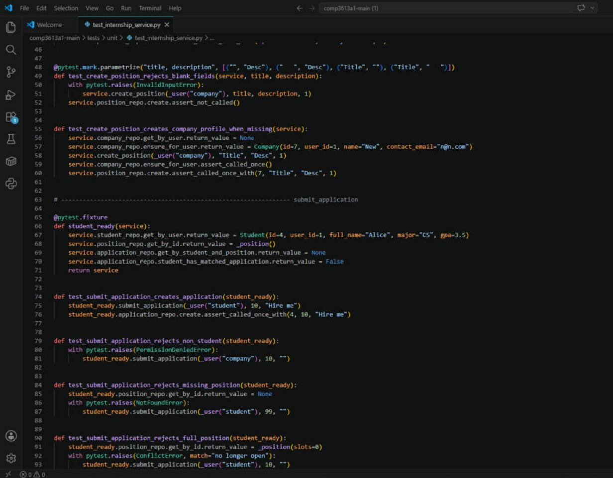

## Integration Tests Implementation

Integration tests are in `tests/integration/` (`test_api_auth.py`, `test_api_positions.py`, `test_api_applications.py`, `test_web_workflows.py`, `test_company_dashboard_view.py`) and run with `python manage.py test integration`. Screenshot of `tests/integration/test_api_applications.py`:

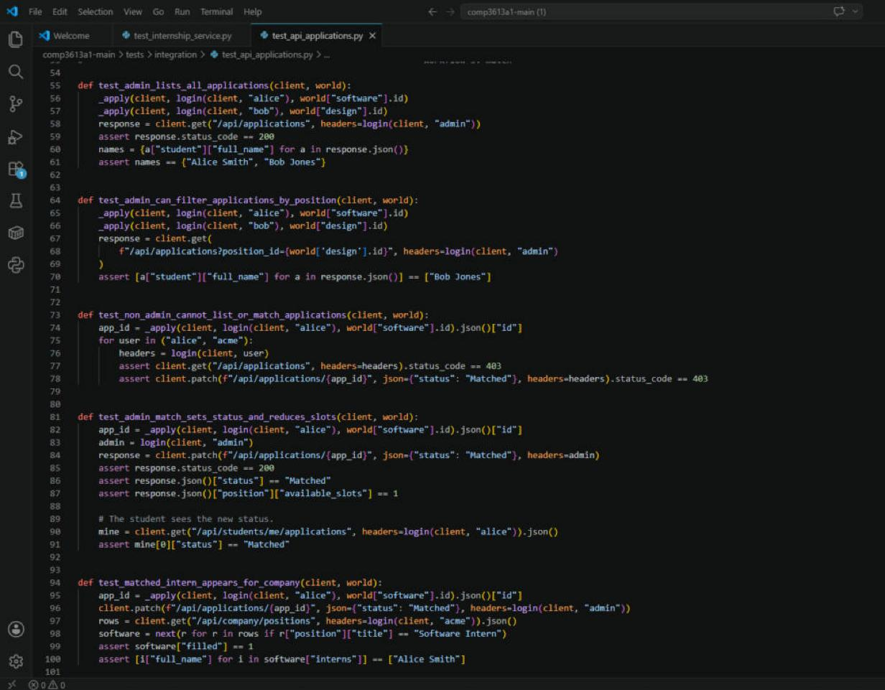

## API Tests Implementation

API tests are implemented with Postman test scripts in the collection `postman/internship-platform.postman_collection.json` (31 requests, 49 tests), on the Scripts (After response) tab of each request. Screenshot of the "Match application (admin)" request in Postman:

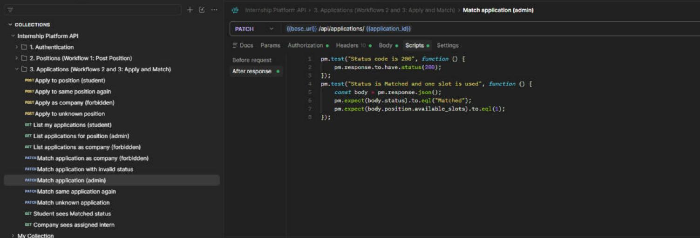

To run them: `python manage.py init`, then `python manage.py run`, then import the collection into Postman and run it with the Collection Runner. Each run registers a new student and posts a new position, so the collection can be run again without resetting the database.

---

# Reports

## Unit Tests Report

Command: `python manage.py test unit -v` (46 passed)

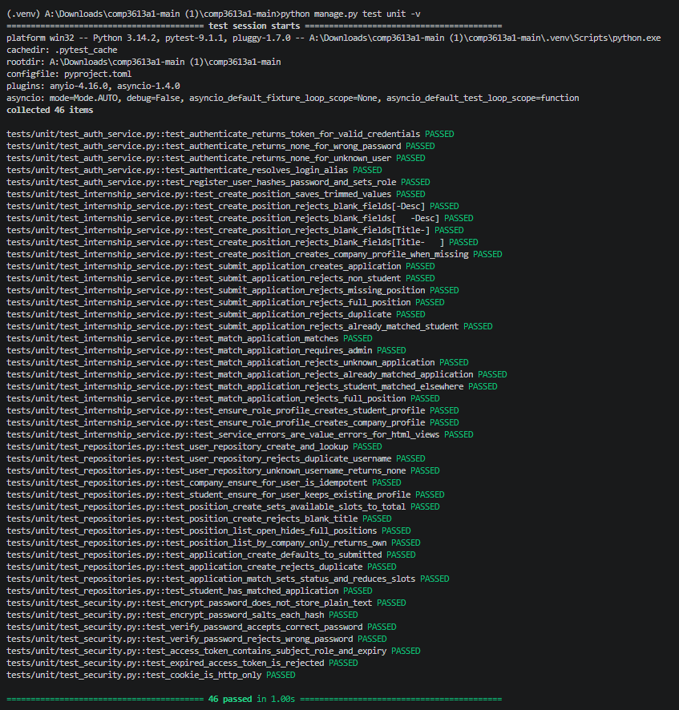

## Integration Tests Report

Command: `python manage.py test integration -v` (43 passed)

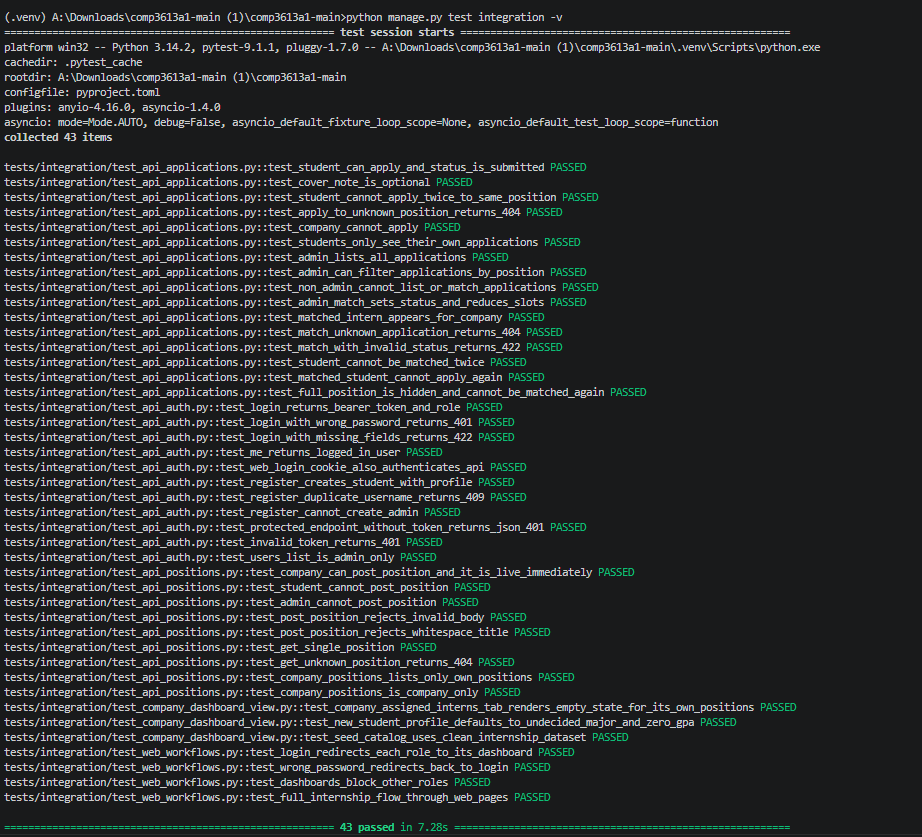

## Postman Collection Run Report

31 requests, 49 tests, 0 errors.

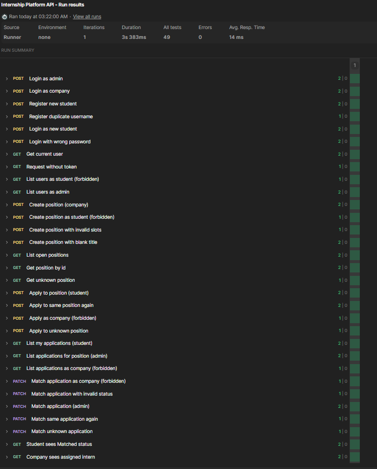

## User Acceptance Test Report

**InternMatch User Acceptance Test Report**

| Tester Name | Tester Position | Date of Test (DD/MM/YYYY) |
|---|---|---|
| Kriston Latoo | Student Developer | 10/11/2026 |

<table class="uat">
<tr><th rowspan="2">Test Case</th><th rowspan="2">Pre-conditions</th><th rowspan="2">Test Steps</th><th rowspan="2">Test Criteria</th><th colspan="2">Success (indicate with a ✓)</th></tr>
<tr><th>Pass</th><th>Fail</th></tr>
<tr><td>1.1 Test Login</td><td>None</td><td>☑ Open http://localhost:5000 and click <b>Sign in</b> ☑ Fill out the form with a valid username and password (admin / adminpass, northwind / companypass or student1 / studentpass) ☑ Press the <b>Sign in</b> button</td><td>☑ An Admin is directed to the <b>Matching Workspace</b> page ☑ A Company is directed to the <b>Post Position</b> page ☑ A Student is directed to the <b>Browse Positions</b> page ☑ <b>Logout</b> is shown at the top right of the navbar</td><td class="pf">✓</td><td class="pf"></td></tr>
<tr><td>1.2 Test Invalid Login</td><td>None</td><td>☑ On the sign-in page enter username <b>admin</b> and a wrong password ☑ Press the <b>Sign in</b> button</td><td>☑ User remains on the sign-in page ☑ User is alerted "Incorrect username or password"</td><td class="pf">✓</td><td class="pf"></td></tr>
<tr><td>1.3 Test Post Position</td><td>☑ Must be logged in as a Company</td><td>☑ On the <b>Post Position</b> page (wireframe W1) fill out the form: Title "UAT Test Intern", a short description, Total Slots 2 ☑ Press the <b>Submit</b> button</td><td>☑ The new position appears at the top of <b>My Positions</b> ☑ The position is marked "Just posted" ☑ The position shows Available slots 2 / 2</td><td class="pf">✓</td><td class="pf"></td></tr>
<tr><td>1.4 Test Post Position with Blank Title</td><td>☑ Must be logged in as a Company</td><td>☑ On the <b>Post Position</b> page (W1) leave Title empty and fill in a description ☑ Press the <b>Submit</b> button</td><td>☑ The form is not submitted ☑ The Title field shows "Please fill out this field." ☑ No new position appears in <b>My Positions</b></td><td class="pf">✓</td><td class="pf"></td></tr>
<tr><td>1.5 Test Browse Positions</td><td>☑ Must be logged in as a Student ☑ Position from 1.3 exists</td><td>☑ On the <b>Browse Positions</b> page (W2) scroll through the list of positions ☑ Click on "UAT Test Intern"</td><td>☑ The new position is listed without any admin approval ☑ The details panel shows the company, description and "Available" status</td><td class="pf">✓</td><td class="pf"></td></tr>
<tr><td>1.6 Test Apply for Internship</td><td>☑ Must be logged in as a Student ☑ The position is open and the student has not applied to it</td><td>☑ On <b>Browse Positions</b> (W2) select "UAT Test Intern" ☑ Type a cover note ☑ Press the <b>Apply</b> button ☑ Select "Marketing Intern", type a cover note and press <b>Apply</b> (needed for 1.11)</td><td>☑ User is alerted "Application submitted successfully." ☑ The details panel shows "Application submitted" and status Submitted ☑ Both applications are submitted</td><td class="pf">✓</td><td class="pf"></td></tr>
<tr><td>1.7 Test Duplicate Application</td><td>☑ Must be logged in as a Student ☑ Student has already applied to "UAT Test Intern"</td><td>☑ On <b>Browse Positions</b> (W2) select "UAT Test Intern" again</td><td>☑ The <b>Apply</b> button and Cover Note box are no longer shown ☑ The position shows status Submitted, so it cannot be applied to twice</td><td class="pf">✓</td><td class="pf"></td></tr>
<tr><td>1.8 Test View My Applications</td><td>☑ Must be logged in as a Student ☑ Student has submitted at least one application</td><td>☑ Click on <b>My Applications</b> in the navbar (W3)</td><td>☑ "UAT Test Intern" is listed ☑ The row shows company Northwind Studio, the cover note and status Submitted</td><td class="pf">✓</td><td class="pf"></td></tr>
<tr><td>1.9 Test View Applicants</td><td>☑ Must be logged in as an Admin ☑ student1 has applied to "UAT Test Intern"</td><td>☑ On the <b>Matching Workspace</b> page (W4) click "UAT Test Intern" under Open Positions</td><td>☑ Student One's application is shown with major, GPA and cover note ☑ Remaining slots shows 2 / 2 ☑ An <b>Assign student</b> button is shown</td><td class="pf">✓</td><td class="pf"></td></tr>
<tr><td>1.10 Test Match Application</td><td>☑ Must be logged in as an Admin ☑ Student One's application to "UAT Test Intern" is pending</td><td>☑ On <b>Matching Workspace</b> (W4) select "UAT Test Intern" ☑ Press <b>Assign student</b> on Student One's application</td><td>☑ User is alerted "Application matched successfully." ☑ The application status changes to Matched ☑ Remaining slots changes to 1 / 2</td><td class="pf">✓</td><td class="pf"></td></tr>
<tr><td>1.11 Test Already Matched Student</td><td>☑ Must be logged in as an Admin ☑ Student One was matched in 1.10 ☑ Student One applied to "Marketing Intern" in 1.6 ☑ Seeded applicants Mia Ross, Noah Chen and Sophia Nguyen have also applied to "Marketing Intern"</td><td>☑ On <b>Matching Workspace</b> (W4) click "Marketing Intern" under Open Positions</td><td>☑ Student One's application shows "Already matched" ☑ Its button is disabled and cannot be pressed ☑ Other applicants still show <b>Assign student</b></td><td class="pf">✓</td><td class="pf"></td></tr>
<tr><td>1.12 Test Matched Status for Student</td><td>☑ Must be logged in as a Student ☑ Student's application was matched in 1.10</td><td>☑ Click on <b>My Applications</b> in the navbar (W3)</td><td>☑ "UAT Test Intern" shows status Matched ☑ The student's other application still shows Submitted</td><td class="pf">✓</td><td class="pf"></td></tr>
<tr><td>1.13 Test View Assigned Interns</td><td>☑ Must be logged in as a Company ☑ A student has been matched to one of its positions</td><td>☑ Click on <b>Assigned Interns</b> in the navbar (W5)</td><td>☑ Student One is listed under "UAT Test Intern" ☑ The position shows 1 / 2 filled ☑ Positions with no matches show "No interns assigned."</td><td class="pf">✓</td><td class="pf"></td></tr>
<tr><td>1.14 Test Role Access Restriction</td><td>☑ Must be logged in as a Student</td><td>☑ Enter http://localhost:5000/admin in the address bar ☑ Enter http://localhost:5000/company in the address bar</td><td>☑ The admin page does not open; a 401 Unauthorized page is shown ☑ The company page does not open; "Company access required" is shown</td><td class="pf">✓</td><td class="pf"></td></tr>
</table>

| General Comments | Accepted &#124; Rejected | Signature |
|---|---|---|
| All 14 test cases passed.  Observations (not failures): • When a non-company user opens /company, the refusal is shown as plain text (`{"detail":"Company access required"}`) instead of a styled error page. • After posting a position, "Position posted successfully." is not shown on the company page; it appears the next time the sign-in page is opened. | Accepted ✓ (with the minor cosmetic observations noted) Rejected ☐ | *Kriston Latoo* |
