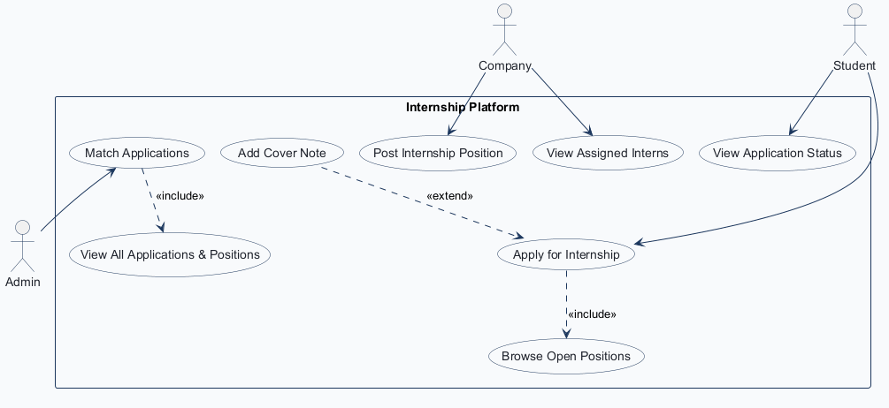
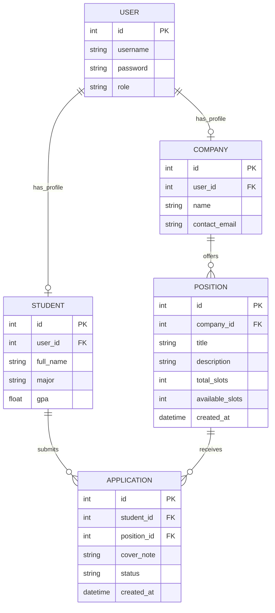
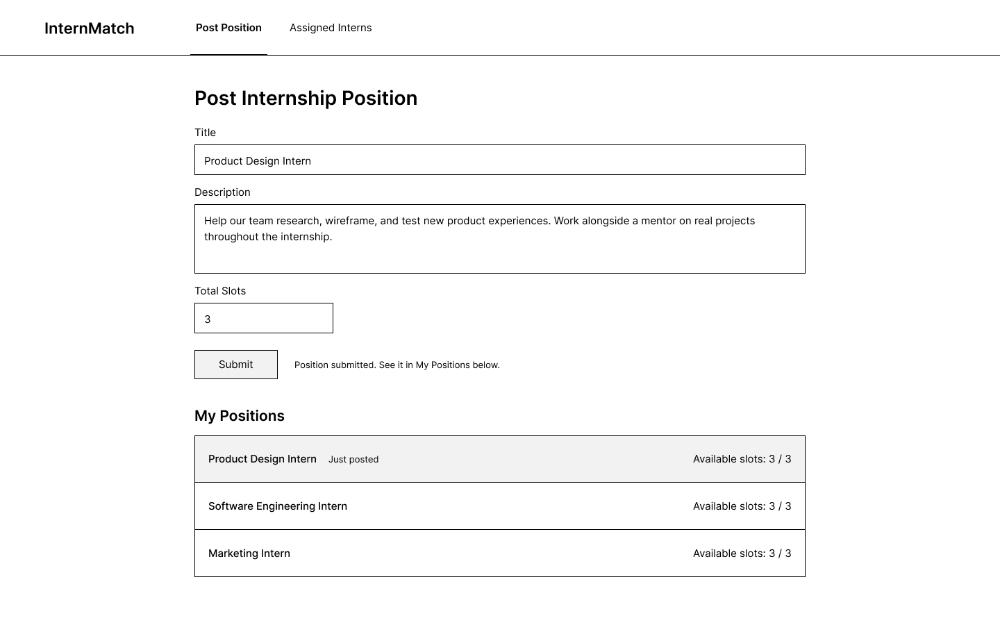
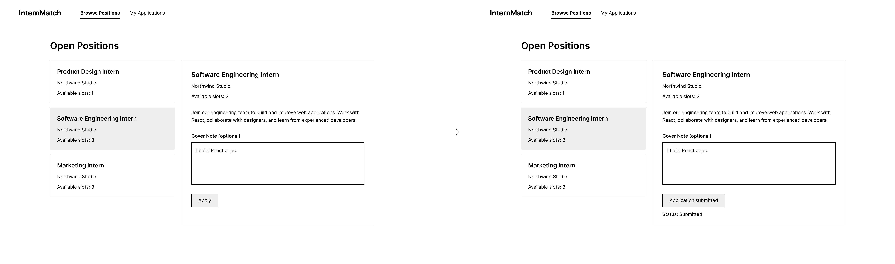
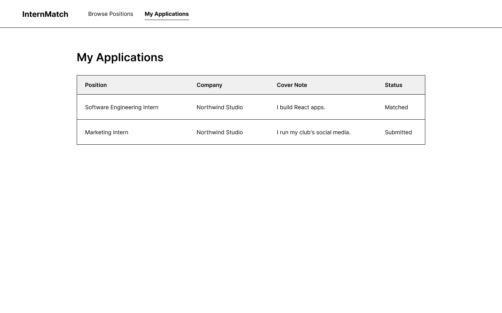
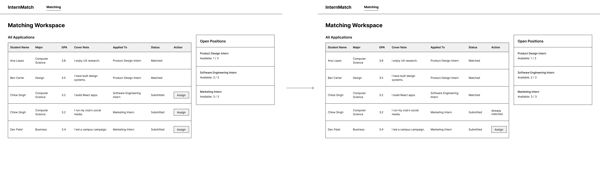
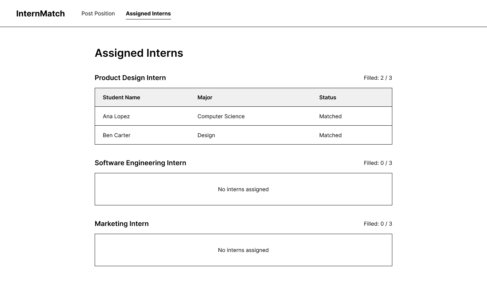

<!-- student-build:skill-integrity
status: pass
root: e84cd692d0b85eefe546385661958c27d07e8be6c5176a82012f68ccff5c8beb
expected_root: e84cd692d0b85eefe546385661958c27d07e8be6c5176a82012f68ccff5c8beb
mismatches: none
-->

# COMP 3613 Assignment 1

Draft this file with the Guide. **Update it after every phase milestone** before you pause. The use-case diagram is a UML PNG at `docs/diagrams/use-case.png`, linked from this file as `diagrams/use-case.png` (path relative to `docs/report.md`). The model diagram is Mermaid. **Embed wireframe images** as `wireframes/<file>` (files live in `docs/wireframes/`).

Do not put your student ID in this file if you will commit it. The PDF cover adds your name and ID at export time.

## Assigned project

Internship Platform

## Three workflows

### 1. Post Internship Position (Company)
Who acts: Company.
Steps: enter position details (title, description, slots) and submit.
Done when: the position is saved and goes live immediately for students to see, with no admin approval.

### 2. Apply for Internship (Student)
Who acts: Student.
Steps: browse open positions, optionally add a cover note, and submit the application (one application per position).
Done when: the application is recorded and its status shows as "Submitted".

### 3. Match Applications (Admin)
Who acts: Admin.
Steps: view all applications and open positions, then manually assign a student to a position.
Done when: the student's application status updates to "Matched" and the company's available slot count decreases by 1.

Assumes seeded accounts; login is not part of the demo.

## Use case diagram

Phase 2 draft: the diagram models the internship platform around the role-based workflows and shared support tasks, while keeping the core MVP focused on posting, applying, and manual matching.

### Primary use cases
- Company: Post Internship Position, View Assigned Interns
- Student: Apply for Internship, View Application Status
- Admin: Match Applications

### Supporting use cases
- Browse Open Positions
- Add Cover Note
- View All Applications & Positions

### Relationships
- Apply for Internship <<include>> Browse Open Positions
- Add Cover Note <<extend>> Apply for Internship
- Match Applications <<include>> View All Applications & Positions

### Business rules captured in the design
- Company positions go live immediately upon posting
- Students can apply to each open position only once
- Matching is strictly manual

## Model diagram

Phase 3 draft: the ERD follows the user-role model you specified, with a single `User` account linked to either a `Company` or `Student` profile, and a `Position`/`Application` relationship that supports the student application workflow and the one-application-per-position rule.

Business rules captured in the model:
- A `User` can be either a company, student, or admin, with admin users having no `Company` or `Student` profile.
- A `User` has one `Company` or one `Student` profile, never both.
- A `Company` can create many `Position` records.
- A `Student` can submit many `Application` records.
- A `Position` can receive many `Application` records.
- `available_slots` is stored on `Position` and decreases by 1 only when an `Application` status becomes `Matched`; it can never go below 0.
- `Application.status` is exactly `Submitted` or `Matched`.
- A student can apply to the same position only once, enforced by the unique constraint on `(student_id, position_id)`.
- A student can be `Matched` to only one position, so once an application is `Matched`, the student's other applications can no longer be assigned.
- `View Assigned Interns` is derived from `Application` rows with status `Matched` for the company's positions.
- On the matching screen, the admin sees the student's `major`, `gpa`, and the `cover_note` to decide which applicant to assign.

## Wireframes

### Post Internship Position (Company)

### Browse Open Positions & Apply for Internship (Student)

### My Applications (Student)

### Match Applications (Admin)

### View Assigned Interns (Company)

### Phase 4 coverage notes
- `Position.title`, `description`, and `total_slots` are visible on the company post form and match the model.
- `Position.available_slots` and `Application.cover_note` are visible in the student application flow and match the ERD.
- `Application.status` transitions from `Submitted` to `Matched` are shown in the admin matching workflow.
- The final assigned-interns view confirms the company-side derivation from matched applications for each posted position.

<!-- student-build:wireframe-coverage
workflow: Post Internship Position (Company)
image: docs/wireframes/post-position.png
-->
<!-- student-build:wireframe-coverage
workflow: Browse Open Positions & Apply for Internship (Student)
image: docs/wireframes/browse-apply.png
-->
<!-- student-build:wireframe-coverage
workflow: My Applications (Student)
image: docs/wireframes/my-applications.png
-->
<!-- student-build:wireframe-coverage
workflow: Match Applications (Admin)
image: docs/wireframes/matching-workspace.png
-->
<!-- student-build:wireframe-coverage
workflow: View Assigned Interns (Company)
image: docs/wireframes/assigned-interns.png
-->

`python manage.py report` also embeds any PNG/JPG still missing from `docs/wireframes/`.

## Theming

Phase 5 branding was updated to a navy-and-gold internship identity for the app shell, landing page, login, register flow, and authenticated dashboards. The earlier orange/teal starter accents were removed. The application now uses a consistent top bar and card styling across company, student, and admin pages, with navy as the primary brand color, gold for highlights and status badges, and sharper contrast for readable text and action buttons.

The same theme is applied to:
- landing page hero / sign-in and sign-up pages
- company post-position form and dashboard shell
- student browse/apply and applications screens
- admin matching workspace and sticky banner alerts

This was refined through verification of the live pages so the look stayed consistent and the role-based layouts all matched the same brand language. In the final polish pass, the landing page no longer displays the demo login list, and a small gold border/accent treatment was added to keep the unauthenticated pages aligned with the more saturated navy-and-gold app shell.

Recent refinements also include:
- new student registrations now receive a default major of `Undecided` and a default GPA of `0.00` so the admin sees a valid student profile immediately
- the student and company dashboards continue to work off the same shared table and profile logic without introducing a mismatch between registration and later profile updates
- all workflow screens are presented under a single InternMatch identity with consistent typography, buttons, and navigation styling

## Implementation notes

The MVP was implemented in workflow slices and verified after each milestone, with the final pass focused on the admin matching workspace and the role-specific UI polish.

### Company workflow: Post Internship Position
- The company can create a position with title, description, and total slot count.
- The position is saved and immediately visible to students with no admin approval step.
- `available_slots` is stored on the position and carries through to the student-facing browse list and admin slot summary.
- Validation prevents blank title/description and enforces a positive slot count.

### Student workflow: Browse Positions and Apply
- The student dashboard uses a left-column browse list and right-side detail panel, matching the user-requested pattern.
- Students can select a position and see its details, company, and current status without the page jumping or losing state.
- Students can submit a cover note and apply once per position.
- Duplicate applications are blocked and students are prevented from applying if they are already matched to another position.
- `My Applications` shows each submitted or matched application, with the status displayed clearly.

### Admin workflow: Match Applications
- The admin page is a matching workspace with a stable top banner for flash messages and a two-column layout.
- The left panel lists open positions; clicking a position filters the right panel to that position's applicants.
- The right panel shows every application for the selected position, including student major, GPA, cover note, and remaining slots.
- Manual assignment is available for pending applications only.
- Assigning a student marks the application as `Matched` and subtracts one slot from the position.
- Full positions are blocked with a clear disabled state; already-matched students are blocked from being assigned again.
- The admin page confirms whether a student has already been matched and prevents assignment on their other applications.
- The open-position summary and the student browse list both read from the same underlying position data to keep slot counts in sync.

### Data and verification notes
- The application data was seeded with multiple users and realistic internship decisions so the workflow was usable from the first login.
- The seed set includes the core admin/company/student accounts and multiple student profiles with different majors and GPAs.
- A database-path bug was found during verification: the app was using a relative SQLite database path and could point at a different file depending on where the server started. This was corrected to always resolve the same project database so the admin and student views read the same records.
- After the fix, the admin dashboard, student dashboard, and direct database row count were checked against the same running app instance to confirm they matched.
- The project remained local-only for this phase; no public deployment was added in Phase 5.

## Deployed app

Phase 6 deployment was completed with the Render MCP.

Public URL: https://faststarter-dc37.onrender.com

- Database wiring: the `faststarter` web service now uses the Render internal Postgres connection (`DATABASE_URI`) for `internmatch-db` in Oregon, so credentials are kept only in Render environment variables.
- Live reset before recording: the production Postgres database was reset and reseeded using the app init flow.
- Postgres verification after reset: `internmatch-db` contains the expected seed data (`users=9`, `companies=2`, `students=6`, `positions=4`, `applications=10`).

- Public health check: https://faststarter-dc37.onrender.com/health returned `{"ok":true}`.
- Seed verification on deployed app: posting `admin/adminpass`, `company1/companypass`, and `student1/studentpass` to `/login` returned `303` redirects to role dashboards, confirming the seeded accounts are present and usable.

## Logins

These are the seeded accounts used for verification and demo use:

- admin / adminpass — admin
- northwind / companypass — company
- company1 / companypass — company
- ava_thompson / studentpass — student
- student1 / studentpass — student
- leo_martinez / studentpass — student
- mia_ross / studentpass — student
- noah_chen / studentpass — student
- sophia_nguyen / studentpass — student

The admin user is the matching workspace account, the northwind user owns the single company profile, and the student accounts each have real majors, GPAs, and multi-position applications so there are meaningful decisions to make in the admin matching workspace.

## YouTube URL

https://www.youtube.com/watch?v=L_pR2C7c56A

## Repository

https://github.com/Cementmixerberk2/comp3613a1

## Agent used

GitHub Copilot

## Account email

kristonlatoo@my.uwi.edu

## Session transcripts

Filled when the Guide builds the report: the agent writes chat markdown into `docs/transcripts/`; `python manage.py report` packages them.

Guide packaged **10** chat(s) in `docs/transcripts/` (and `docs/transcripts.zip`).

Index: [docs/transcripts/INDEX.md](transcripts/INDEX.md)

- [`3166d047-5ea6-4d18-8e69-f4940d8abf56-chat-3166d047-5ea6-4d18-8e69-f4940d8abf56`](transcripts/3166d047-5ea6-4d18-8e69-f4940d8abf56-chat-3166d047-5ea6-4d18-8e69-f4940d8abf56.md)
- [`4d7a7522-9ffc-4cb3-aa90-b9c7ede60e95-start-phase-4-with-wireframes`](transcripts/4d7a7522-9ffc-4cb3-aa90-b9c7ede60e95-start-phase-4-with-wireframes.md)
- [`55e8e01d-97d9-436a-b413-7e47ba905487-chat-55e8e01d-97d9-436a-b413-7e47ba905487`](transcripts/55e8e01d-97d9-436a-b413-7e47ba905487-chat-55e8e01d-97d9-436a-b413-7e47ba905487.md)
- [`5fb4d681-4dc2-4ff4-a1a8-6cc517dfbf21-chat-5fb4d681-4dc2-4ff4-a1a8-6cc517dfbf21`](transcripts/5fb4d681-4dc2-4ff4-a1a8-6cc517dfbf21-chat-5fb4d681-4dc2-4ff4-a1a8-6cc517dfbf21.md)
- [`9ce0547d-1eae-4f9b-acd6-cfc195fd5f45-use-case-diagram-from-phase-1`](transcripts/9ce0547d-1eae-4f9b-acd6-cfc195fd5f45-use-case-diagram-from-phase-1.md)
- [`a23e4aea-6746-4c2b-b083-a49aedce9547-chat-a23e4aea-6746-4c2b-b083-a49aedce9547`](transcripts/a23e4aea-6746-4c2b-b083-a49aedce9547-chat-a23e4aea-6746-4c2b-b083-a49aedce9547.md)
- [`a6e98219-86ee-47b3-a08b-05d1cdd7c061-start-phase-5`](transcripts/a6e98219-86ee-47b3-a08b-05d1cdd7c061-start-phase-5.md)
- [`d1206872-162d-4db5-8828-2cadba83e847-start-phase-3`](transcripts/d1206872-162d-4db5-8828-2cadba83e847-start-phase-3.md)
- [`d7303084-30fe-4336-818b-c877cd042c38-start-phase-6`](transcripts/d7303084-30fe-4336-818b-c877cd042c38-start-phase-6.md)
- [`ef763979-e413-4b22-a00b-04978b8ad3eb-start-assignment-with-build-skill`](transcripts/ef763979-e413-4b22-a00b-04978b8ad3eb-start-assignment-with-build-skill.md)

## Competency (student-judge)

Filled by Guide from the student-judge run when this report was built.

**Judged at:** 2026-10-12T23:38:54.1952678-04:00
**Evidence pass:** re-read all available native Copilot workspace chats + current docs/report.md + docs/diagrams + docs/wireframes + docs/transcripts/*.md (prior judge ignored)

**Student / session:** COMP 3613 Assignment 1 (Internship Platform)
**Artifact:** Copilot Agent chats for this workspace and docs/report.md + docs/transcripts dump
**Phases in evidence:** 1–6 (COMP 3613; Phase 5 polish, Phase 6 deploy; never generic 0–5)

### Totals
| | Count / value |
|--|--|
| Metrics on rubric | 12 (M1–M12) |
| N/A (excluded) | 0 |
| Metrics scored | 12 |
| Scoreable max | 48 |
| Awarded total | 40 / 48 |
| **Overall (avg of scored)** | **3.33 / 4** |
| Impression mark | 17 / 20 |

## Scorecard

| ID | Metric | Score / 4 | In avg | Evidence |
|----|--------|----------:|:------:|----------|
| M1 | Phase discipline | 3 | yes | Separate phase-start chats exist for phases 1/3/4/5/6 and phase sequence is preserved in transcripts and report updates. |
| M2 | Problem framing | 3 | yes | Early chats cover workflows/use cases, then model and wireframe discussions are continued before implementation/deploy. |
| M3 | Decision ownership | 3 | yes | Student repeatedly steered decisions: start phase prompts, deploy target, Postgres rewiring, live reset request, and transcript completeness request. |
| M4 | Artefact-before-code | 4 | yes | The run progressed through use-case/model/wireframe artifacts before deployment and used report/diagrams as source-of-truth. |
| M5 | Verification habit | 4 | yes | Strong verification loop: health checks, login checks, DB row-count queries, redeploy verification, and post-reset checks were repeated until stable. |
| M6 | Assignment fit | 3 | yes | FastStarter structure and assignment constraints were followed; Render deploy + seeded roles validated; no out-of-scope architecture rewrite introduced. |
| M7 | Slice explanation | 3 | yes | Workflow-level outcomes were checked and explained during phase 5/6 (auth, admin/company/student behavior, seed/reset behavior). |
| M8 | Prompt quality | 4 | yes | Prompts were concrete and phase-scoped, with precise operational asks: connect existing DB, fix config/driver, redeploy, reset now, pull all guide chats. |
| M9 | Response to pushback | 4 | yes | Student did not accept partial states; kept pushing on deploy mismatch, missing seed users, and transcript completeness until addressed. |
| M10 | Integrity | 3 | yes | No clear signs of transcript tampering or answer-laundering; evidence aligns across chats, report, and live checks. |
| M11 | Provenance continuity | 3 | yes | Decisions and fixes stayed anchored to this repo and deployment artifacts across phases. |
| M12 | Sincerity trajectory | 3 | yes | No sincerity-spiral blocks present; trajectory inferred from consistent iterative ownership and verification behavior. |

## Strengths
- Full phase coverage exists across multiple chats, not only a single deployment chat.
- Strong operational rigor in Phase 6: deploy, DB binding, reseed/reset, and live login verification all evidenced.
- Student actively governed quality by requiring all chat transcripts to be included before final judging.

## Gaps (priority order)
1. No material competency gaps found after the fresh full-chat evidence pass.

## Phase gate status
| Phase | Status | Note |
|-------|--------|------|
| 1 | met | Assignment start/session evidence and phase framing present. |
| 2 | met | Use-case work evidenced in dedicated phase chat transcript. |
| 3 | met | Model/ERD phase evidenced in dedicated phase chat transcript. |
| 4 | met | Wireframe phase evidenced in dedicated phase chat transcript and report embeds. |
| 5 | met | Implementation/polish progression evidenced in phase 5 chat. |
| 6 | met | Public deploy, DB connectivity, reset, and login checks evidenced in phase 6 chat and report. |

## Recommended next practice
- Before final export, run one short manual smoke pass: health endpoint, admin login, company login, student login, one apply action, one match action.

## Integrity note
- Clean

## Provenance flags
- none

## Skill integrity

Course skills are hashed at export and compared to `.agents/skills.lock.json`. Do not edit `.agents/skills/`, `.cursor/skills/`, or `AGENTS.md`.

- Status: **pass**
- Root: `e84cd692d0b85eefe546385661958c27d07e8be6c5176a82012f68ccff5c8beb`
- none
