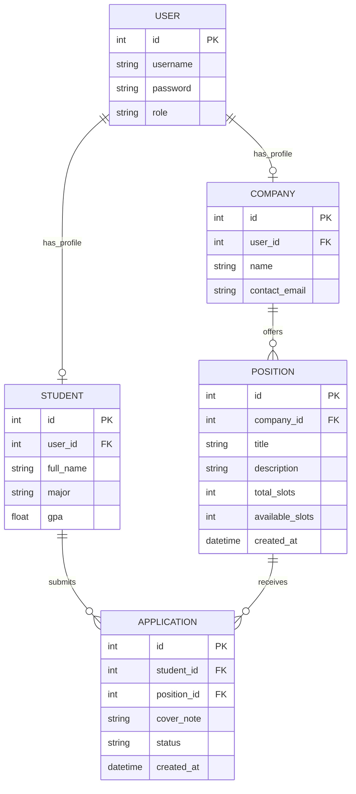

# COMP 3613 Assignment 1

Draft this file with the Guide. **Update it after every phase milestone** before you pause. The use-case diagram is a UML PNG at `docs/diagrams/use-case.png`, linked from this file as `diagrams/use-case.png` (path relative to `docs/report.md`). The model diagram is Mermaid. **Embed wireframe images** as `wireframes/<file>` (files live in `docs/wireframes/`).

Do not put your student ID in this file if you will commit it. The PDF cover adds your name and ID at export time.

## Assigned project

Internship Platform

## Three workflows

### 1. Post Internship Position (Company)
Who acts: Company.
Steps: enter position details (title, description, slots) and submit.
Done when: the position is saved and goes live immediately for students to see, with no admin approval.

### 2. Apply for Internship (Student)
Who acts: Student.
Steps: browse open positions, optionally add a cover note, and submit the application (one application per position).
Done when: the application is recorded and its status shows as "Submitted".

### 3. Match Applications (Admin)
Who acts: Admin.
Steps: view all applications and open positions, then manually assign a student to a position.
Done when: the student's application status updates to "Matched" and the company's available slot count decreases by 1.

Assumes seeded accounts; login is not part of the demo.

## Use case diagram

Phase 2 draft: the diagram models the internship platform around the role-based workflows and shared support tasks, while keeping the core MVP focused on posting, applying, and manual matching.

### Primary use cases
- Company: Post Internship Position, View Assigned Interns
- Student: Apply for Internship, View Application Status
- Admin: Match Applications

### Supporting use cases
- Browse Open Positions
- Add Cover Note
- View All Applications & Positions

### Relationships
- Apply for Internship <<include>> Browse Open Positions
- Add Cover Note <<extend>> Apply for Internship
- Match Applications <<include>> View All Applications & Positions

### Business rules captured in the design
- Company positions go live immediately upon posting
- Students can apply to each open position only once
- Matching is strictly manual

## Model diagram

Phase 3 draft: the ERD follows the user-role model you specified, with a single `User` account linked to either a `Company` or `Student` profile, and a `Position`/`Application` relationship that supports the student application workflow and the one-application-per-position rule.

Business rules captured in the model:
- A `User` can be either a company, student, or admin, with admin users having no `Company` or `Student` profile.
- A `User` has one `Company` or one `Student` profile, never both.
- A `Company` can create many `Position` records.
- A `Student` can submit many `Application` records.
- A `Position` can receive many `Application` records.
- `available_slots` is stored on `Position` and decreases by 1 only when an `Application` status becomes `Matched`; it can never go below 0.
- `Application.status` is exactly `Submitted` or `Matched`.
- A student can apply to the same position only once, enforced by the unique constraint on `(student_id, position_id)`.
- A student can be `Matched` to only one position, so once an application is `Matched`, the student's other applications can no longer be assigned.
- `View Assigned Interns` is derived from `Application` rows with status `Matched` for the company's positions.
- On the matching screen, the admin sees the student's `major`, `gpa`, and the `cover_note` to decide which applicant to assign.

## Wireframes

### Post Internship Position (Company)

### Browse Open Positions & Apply for Internship (Student)

### My Applications (Student)

### Match Applications (Admin)

### View Assigned Interns (Company)

### Phase 4 coverage notes
- `Position.title`, `description`, and `total_slots` are visible on the company post form and match the model.
- `Position.available_slots` and `Application.cover_note` are visible in the student application flow and match the ERD.
- `Application.status` transitions from `Submitted` to `Matched` are shown in the admin matching workflow.
- The final assigned-interns view confirms the company-side derivation from matched applications for each posted position.

<!-- student-build:wireframe-coverage
workflow: Post Internship Position (Company)
image: docs/wireframes/post-position.png
-->
<!-- student-build:wireframe-coverage
workflow: Browse Open Positions & Apply for Internship (Student)
image: docs/wireframes/browse-apply.png
-->
<!-- student-build:wireframe-coverage
workflow: My Applications (Student)
image: docs/wireframes/my-applications.png
-->
<!-- student-build:wireframe-coverage
workflow: Match Applications (Admin)
image: docs/wireframes/matching-workspace.png
-->
<!-- student-build:wireframe-coverage
workflow: View Assigned Interns (Company)
image: docs/wireframes/assigned-interns.png
-->

`python manage.py report` also embeds any PNG/JPG still missing from `docs/wireframes/`.

## Theming

Phase 5 branding was updated to a navy-and-gold internship identity for the app shell, landing page, login, register flow, and authenticated dashboards. The earlier orange/teal starter accents were removed. The application now uses a consistent top bar and card styling across company, student, and admin pages, with navy as the primary brand color, gold for highlights and status badges, and sharper contrast for readable text and action buttons.

The same theme is applied to:
- landing page hero / sign-in and sign-up pages
- company post-position form and dashboard shell
- student browse/apply and applications screens
- admin matching workspace and sticky banner alerts

This was refined through verification of the live pages so the look stayed consistent and the role-based layouts all matched the same brand language. In the final polish pass, the landing page no longer displays the demo login list, and a small gold border/accent treatment was added to keep the unauthenticated pages aligned with the more saturated navy-and-gold app shell.

Recent refinements also include:
- new student registrations now receive a default major of `Undecided` and a default GPA of `0.00` so the admin sees a valid student profile immediately
- the student and company dashboards continue to work off the same shared table and profile logic without introducing a mismatch between registration and later profile updates
- all workflow screens are presented under a single InternMatch identity with consistent typography, buttons, and navigation styling

## Implementation notes

The MVP was implemented in workflow slices and verified after each milestone, with the final pass focused on the admin matching workspace and the role-specific UI polish.

### Company workflow: Post Internship Position
- The company can create a position with title, description, and total slot count.
- The position is saved and immediately visible to students with no admin approval step.
- `available_slots` is stored on the position and carries through to the student-facing browse list and admin slot summary.
- Validation prevents blank title/description and enforces a positive slot count.

### Student workflow: Browse Positions and Apply
- The student dashboard uses a left-column browse list and right-side detail panel, matching the user-requested pattern.
- Students can select a position and see its details, company, and current status without the page jumping or losing state.
- Students can submit a cover note and apply once per position.
- Duplicate applications are blocked and students are prevented from applying if they are already matched to another position.
- `My Applications` shows each submitted or matched application, with the status displayed clearly.

### Admin workflow: Match Applications
- The admin page is a matching workspace with a stable top banner for flash messages and a two-column layout.
- The left panel lists open positions; clicking a position filters the right panel to that position's applicants.
- The right panel shows every application for the selected position, including student major, GPA, cover note, and remaining slots.
- Manual assignment is available for pending applications only.
- Assigning a student marks the application as `Matched` and subtracts one slot from the position.
- Full positions are blocked with a clear disabled state; already-matched students are blocked from being assigned again.
- The admin page confirms whether a student has already been matched and prevents assignment on their other applications.
- The open-position summary and the student browse list both read from the same underlying position data to keep slot counts in sync.

### Data and verification notes
- The application data was seeded with multiple users and realistic internship decisions so the workflow was usable from the first login.
- The seed set includes the core admin/company/student accounts and multiple student profiles with different majors and GPAs.
- A database-path bug was found during verification: the app was using a relative SQLite database path and could point at a different file depending on where the server started. This was corrected to always resolve the same project database so the admin and student views read the same records.
- After the fix, the admin dashboard, student dashboard, and direct database row count were checked against the same running app instance to confirm they matched.
- The project remained local-only for this phase; no public deployment was added in Phase 5.

## Deployed app

Phase 6 deployment is intentionally left blank for this submission. The work was verified locally and the app was checked on localhost ports during implementation, but no public Render deployment was created in this phase.

https://

## Logins

These are the seeded accounts used for verification and demo use:

- admin / adminpass — admin
- northwind / companypass — company
- ava_thompson / studentpass — student
- leo_martinez / studentpass — student
- mia_ross / studentpass — student
- noah_chen / studentpass — student
- sophia_nguyen / studentpass — student

The admin user is the matching workspace account, the northwind user owns the single company profile, and the student accounts each have real majors, GPAs, and multi-position applications so there are meaningful decisions to make in the admin matching workspace.

## YouTube URL

## Session transcripts

Filled when the Guide builds the report: the agent writes each Guide chat to `docs/transcripts/<slug>.md` (Copilot Agent, Cursor, or OpenCode). `python manage.py report` packages them. Do not paste chats here during the build.

## Competency (student-judge)

Filled when the report is built. Guide runs student-judge, writes `docs/judge.md`, and export appends the scorecard here.

## Skill integrity

Filled by `python manage.py report`. Do not edit the course skills.
